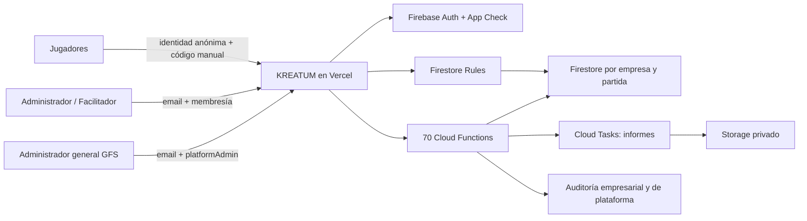

# Memoria de evolución de KREATUM

**Periodo analizado:** 3–13 de agosto de 2026

**Corte técnico:** commit `42c2c99` de la rama `codex/production-release-2026-08-13`

**Producción:** [kreatum-app.vercel.app](https://kreatum-app.vercel.app) · Firebase `kreatum-dinamic`

**Destinatarios:** GFS, comprador de la plataforma, responsables operativos y equipo técnico

## 1. Resumen ejecutivo

KREATUM ha evolucionado de una aplicación de juego con un panel administrativo básico a una plataforma empresarial multiempresa, gobernada y auditable.

La metodología original se conserva: cuatro equipos, siete fases, control del Alquimista y entrada manual del jugador mediante código de sala. El cambio principal no está en la dinámica, sino en todo lo que la rodea: identidad empresarial, aislamiento de datos, licencias, gestión de facilitadores, reconexión, informes profesionales, trazabilidad, resiliencia, pruebas y operación segura en producción.

El resultado actual permite que GFS dé de alta empresas, controle sus partidas contratadas, invite o retire facilitadores y supervise la operación. Cada empresa trabaja únicamente con sus propios datos. Un facilitador de una empresa no puede leer, inferir ni descargar partidas o informes de otra. GFS conserva una vista global exclusiva, protegida por un rol de plataforma y por auditoría.

La versión está desplegada y ha superado el gate completo de release y dos pruebas controladas en producción. El uso debe mantenerse como lanzamiento gestionado mientras finaliza la observación de App Check y se resuelve el riesgo temporal de una dependencia del generador PPTX descrito en este documento.

## 2. Alcance y método de investigación

La memoria cruza cinco tipos de evidencia:

1. Historial Git y comparación entre el último `main` anterior y la rama de producción.
2. Arquitectura, reglas, backend, contratos y pruebas del repositorio.
3. Manifiesto reproducible del gate final del commit desplegado.
4. Inventario real de Firebase, Vercel, IAM, Firestore y Storage.
5. Smokes reales de producción con dos empresas efímeras y limpieza posterior verificada.

### Limitación cronológica importante

El trabajo operativo se inició el 3 de agosto, pero Git no contiene commits alcanzables entre el 3 y el 12. La consolidación versionada aparece el 13 de agosto, en seis commits de release. Por tanto, esta memoria puede demostrar qué cambió entre el punto de partida y el estado final, pero no atribuir con rigor cada cambio a un día concreto del 3 al 12.

El punto de comparación reproducible es `96aeb74`, último commit de `main` anterior a la release, fechado el 15 de junio. El periodo de trabajo declarado por el equipo es 3–13 de agosto; la evidencia Git quedó concentrada el día 13.

## 3. Antes: situación de partida

KREATUM ya tenía valor funcional:

- juego de innovación con cuatro equipos;
- recorrido por las siete fases;
- panel básico del Alquimista;
- creación de partidas y código de sala;
- historial y exportación CSV;
- un generador de informes separado;
- autenticación administrativa por email.

Sin embargo, esa autenticación por email todavía no constituía un modelo empresarial seguro. En las reglas, disponer de un email equivalía prácticamente a ser administrador y un usuario autenticado podía acceder a lecturas globales. Tampoco existían organizaciones aisladas, membresías autoritativas, gobierno de licencias, plataforma GFS, ciclo de vida de facilitadores ni auditoría integral.

Principales limitaciones del punto de partida:

- autorización demasiado amplia basada en estar autenticado y tener email;
- lecturas globales de partidas, equipos, ataques, defensas y soluciones;
- códigos de sala sin reserva transaccional robusta;
- defensas asociadas posicionalmente, con riesgo de relacionarlas con el ataque equivocado;
- informes fuera del flujo principal y sin una fuente canónica versionada;
- ausencia de backend privilegiado y de controles multiempresa completos;
- sin Rules de Storage dedicadas;
- sin pruebas de Rules, integración, E2E, carga o puerta de release;
- sin trazabilidad empresarial ni procedimientos reproducibles de despliegue, backup y rollback.

## 4. Después: capacidades actuales

### 4.1 Acceso e identidades

Desde el 3 de agosto, el acceso administrativo autenticado por email pasa a formar parte del modelo empresarial endurecido. El email identifica al usuario, pero nunca concede acceso por sí solo: el servidor exige una membresía activa, una organización concreta y un rol válido.

Se distinguen dos flujos que no deben confundirse:

- **Administrador o facilitador:** inicia sesión con email y trabaja únicamente dentro de las empresas y partidas autorizadas.
- **Jugador:** no necesita cuenta empresarial ni email. Firebase crea una identidad anónima temporal; el jugador introduce manualmente el código de sala y elige equipo.

Roles operativos:

- **Administrador de empresa (`owner`):** gestiona la empresa, usuarios, invitaciones, historial, auditoría y partidas propias.
- **Facilitador (`facilitator`):** opera las partidas que tiene asignadas dentro de su empresa.
- **Administrador general GFS (`platformAdmin`):** gobierna la plataforma completa desde `/platform`; no se obtiene por email ni por pertenecer a una empresa, sino mediante un claim exclusivo, concedido y auditado.

### 4.2 Plataforma GFS multiempresa

La nueva Plataforma GFS permite:

- crear empresas y definir nombre, dominio y vigencia;
- registrar partidas contratadas, usadas y disponibles;
- invitar al primer responsable de cada empresa;
- buscar y filtrar empresas y partidas;
- consultar datos globales con motivo obligatorio y traza de auditoría;
- asignar partidas únicamente a facilitadores reales y activos de la empresa;
- suspender o reactivar una empresa sin afectar a las demás;
- desactivar o reactivar a un facilitador solo dentro de una empresa;
- ajustar licencias mediante operaciones transaccionales y auditadas.

La desactivación empresarial de un facilitador no bloquea automáticamente su cuenta global ni su acceso legítimo a otra empresa. Esto permite que una misma persona colabore con más de una organización sin que una baja local cause una interrupción transversal.

### 4.3 Panel de empresa y Alquimista

El panel autenticado reúne:

- inicio y saldo de partidas;
- creación, reanudación y finalización;
- historial con búsqueda y filtros;
- equipo y accesos;
- actividad y auditoría;
- archivo, papelera y restauración durante 30 días;
- exportación CSV saneada;
- estados explícitos de carga, error, reintento y cierre de sesión.

Los administradores de empresa pueden ver todas las partidas de su propia organización, incluidas partidas históricas o legacy. Los facilitadores solo ven lo que les corresponde. El administrador general de GFS puede consultar todas las empresas desde la plataforma, con controles y auditoría adicionales.

### 4.4 Invitaciones y ciclo de vida de usuarios

El onboarding empresarial incorpora:

- invitación con enlace y código de verificación;
- caducidad y límite de intentos;
- reenvío controlado y cancelación;
- aceptación vinculada a la identidad real autenticada;
- cambio de rol y estado;
- protección para no eliminar al último administrador activo;
- revocación de sesiones cuando corresponde;
- auditoría sin exponer códigos, tokens ni identificadores crudos.

Una empresa puede contratar una partida, recibir una cuenta administrativa o de facilitación, operar el taller y, al finalizar, quedar con el acceso suspendido o desactivado hasta una contratación futura. GFS puede asignar después a otra persona o departamento sin abrir datos de otras empresas.

### 4.5 Juego preservado y reforzado

El contrato funcional permanece intacto:

1. Selección
2. Calcinar
3. Diluir
4. Conjugar
5. Sublimar
6. Fermentar
7. Proyectar

Equipos: Agua, Fuego, Aire y Tierra.

Mejoras incorporadas sin alterar la metodología:

- código manual de sala de 4 a 10 caracteres;
- reserva privada y transaccional del código;
- máximo de cuatro equipos y un dispositivo activo por equipo;
- heartbeat y expiración de sesiones;
- reconexión explícita solo para la misma identidad anónima;
- liberación y reasignación controlada de jugadores;
- guardado con revisión confirmada;
- transición solicitada, reconocida por los cuatro equipos y confirmada;
- cierre automático y eliminación del código activo;
- rate limits globales y por código contra enumeración;
- operaciones idempotentes para que un reintento no duplique acciones.

### 4.6 Veracidad de ataques, defensas e informes

Las defensas ya no dependen de la posición de un elemento en una lista. Cada defensa se vincula mediante el `attackId` canónico, evitando que borrar o reordenar un ataque asocie una mitigación al ataque equivocado.

Los informes se generan desde un snapshot canónico e inmutable de lo realmente persistido. El sistema ofrece:

- PDF listo para entregar;
- PPTX editable;
- JSON estructurado;
- generación asíncrona mediante cola;
- estado recuperable si el proceso tarda o se reinicia;
- publicación versionada;
- hash SHA-256;
- descarga mediante URL firmada de corta duración;
- auditoría de generación y descarga;
- anexo editorial separado del contenido original.

El informe de una empresa nunca se obtiene mediante una ruta pública ni desde el navegador de otra empresa. La autorización se revalida antes de generar la URL firmada.

### 4.7 Aislamiento y seguridad multiempresa

El principio central es: **la empresa A no puede leer, inferir ni descargar datos o informes de la empresa B**.

Controles aplicados:

- Firestore y Storage con denegación por defecto;
- autorización server-side por organización, membresía, rol, partida y estado;
- respuestas uniformes de “no encontrado” para evitar oráculos de existencia;
- revalidación dentro de transacciones para impedir carreras de revocación o reasignación;
- operaciones privilegiadas idempotentes y auditadas;
- sesiones de jugadores limitadas a una partida y equipo;
- informes bajo rutas canónicas por organización y partida;
- descargas firmadas y auditadas;
- rate limiting de acceso y plataforma;
- App Check registrado y desplegado en modo observación;
- cabeceras web CSP, HSTS, `nosniff`, protección de framing y permisos restrictivos.

### 4.8 Resiliencia y recuperación

La plataforma incorpora:

- reintentos seguros con claves idempotentes;
- timeouts visibles y estados recuperables;
- warmup del flujo de informes para cold starts;
- trabajos de informes persistidos y encolados;
- Firestore PITR y protección contra borrado;
- backup diario con retención de 14 días;
- soft delete de Storage durante 7 días;
- snapshot pre-UBLA verificado;
- procedimientos documentados de despliegue, rollback, migración e IAM.

No se promete que un sistema conectado “jamás se congele”. Lo verificable es que una espera no queda indefinida: existe timeout, error visible, reintento seguro o recuperación.

### 4.9 UX, responsive y accesibilidad

La interfaz fue ampliada para móvil, tablet, portátil y proyector:

- layouts entre 320 y 1920 px;
- navegación adaptable y desplazable;
- formularios apilables y tablas con scroll controlado;
- controles táctiles de al menos 44 px;
- foco visible y operación por teclado;
- labels, landmarks y diálogos accesibles;
- estados `alert` y `status` anunciables;
- reducción de movimiento cuando el sistema lo solicita;
- acciones de ataque y defensa utilizables también en pantallas táctiles.

## 5. Comparativa resumida

| Área | Antes | Ahora |
| --- | --- | --- |
| Identidad administrativa | Email con privilegios demasiado amplios | Email + membresía activa + rol + organización |
| Jugadores | Acceso poco acotado | Identidad anónima temporal + código manual + sesión por equipo |
| Empresas | Modelo global | Multiempresa con aislamiento completo |
| Gobierno GFS | No existía | Plataforma global exclusiva y auditada |
| Licencias | Sin control comercial integrado | Contratadas/usadas/disponibles y ajustes transaccionales |
| Facilitadores | Sin ciclo de vida tenant | Invitar, asignar, desactivar y reactivar por empresa |
| Partidas | Flujo básico | Reconexión, heartbeat, ACK de cuatro equipos e idempotencia |
| Informes | Builder separado | PDF/PPTX/JSON canónicos, encolados, firmados y auditados |
| Auditoría | Parcial o inexistente | Actividad empresarial y de plataforma con motivo y filtros |
| Storage | ACL heredadas | UBLA + prevención de acceso público + URLs firmadas |
| Backend | Sin frontera privilegiada consolidada | 70 Cloud Functions con cuenta runtime dedicada |
| Calidad | Lint/build básicos | Gate integral reproducible y bloqueante |
| Producción | Evidencia parcial | Deploy, smoke multiempresa, backup y cleanup verificados |

## 6. Arquitectura actual

Inventario de producción al corte:

- 70 Functions activas;
- 67 en `europe-southwest1` y 3 en `europe-west1`;
- 62 callables, 5 Eventarc, 2 programadas y 1 worker de tareas;
- las 70 usan una cuenta de servicio runtime dedicada;
- las cuentas por defecto ya no tienen rol `Editor`;
- Storage con UBLA y prevención de acceso público activas;
- Firestore con PITR, protección contra borrado y backups diarios;
- frontend Vercel con assets versionados, cabeceras de seguridad y sin sourcemaps públicos.

## 7. Capacidad y rendimiento: qué puede afirmarse

### Prueba local específica de 25 partidas

El 13 de agosto se repitió una prueba aislada en Firestore Emulator con:

- 25 partidas;
- 25 administradores;
- 100 sesiones de participantes;
- 5.000 eventos de auditoría;
- 100 guardados concurrentes;
- error rate: 0 %;
- control p95: 128 ms;
- guardado p95: 261 ms;
- listado: 154 ms;
- detalle: 43 ms;
- overview de auditoría: 824 ms.

Esto demuestra que el modelo de datos y las operaciones directas de la prueba sostienen 25 partidas en un entorno local controlado con margen frente a los umbrales del test.

### Lo que no demuestra

No es una garantía contractual de 25 partidas simultáneas reales en producción. La prueba no reproduce completamente navegador, Auth, Rules, red pública, cold starts, cuotas, generación simultánea de informes ni una sesión prolongada.

La conclusión responsable es:

> KREATUM tiene evidencia técnica local favorable para 25 partidas y una arquitectura configurada para escalar horizontalmente, pero necesita una carga real escalonada y un soak antes de convertir esa cifra en SLA comercial.

Pendiente para SLA:

1. carga real 25/50/100;
2. soak mínimo de 8 horas;
3. alertas de latencia, errores, instancias, cuotas y presupuesto;
4. RPO/RTO medidos en una restauración aislada.

## 8. Evidencia de calidad y producción

El gate final se ejecutó sobre el commit limpio `42c2c99` y produjo `releaseEligible=true` y `fullGate=true`.

Incluyó:

- lint;
- typecheck de frontend y Functions;
- unitarias de cliente y backend;
- Rules de Firestore y Storage;
- integraciones de Functions;
- E2E general;
- E2E de acceso e invitaciones;
- E2E de informes;
- prueba de carga;
- migraciones;
- builds de frontend y Functions;
- auditoría de seguridad.

Dos smokes reales posteriores validaron:

- dos empresas y dos facilitadores;
- cuatro jugadores por empresa y rechazo del quinto;
- reconexión de la misma identidad y rechazo de una identidad distinta;
- siete fases, cuatro reconocimientos por transición y cierre;
- aislamiento bidireccional entre empresas;
- informes PDF, PPTX y JSON con hashes;
- descarga autorizada y cruce denegado;
- suspensión/reactivación de empresa;
- desactivación/reactivación de facilitador por empresa;
- auditoría;
- limpieza posterior sin residuos de organizaciones, partidas, usuarios, códigos, comandos ni objetos de informe.

El snapshot pre-UBLA verificó 18 objetos y 76.910.843 bytes mediante ruta, tamaño, CRC32C, MD5 y SHA-256.

## 9. Cronología Git verificable

| Fecha | Commit | Resultado principal |
| --- | --- | --- |
| 15 jun | `96aeb74` | Baseline de `main`: juego y panel previo |
| 3–12 ago | — | Trabajo operativo sin commits alcanzables; no se puede separar por día |
| 13 ago 09:40 | `8871600` | Plataforma multiempresa, backend, Rules, informes, auditoría, pruebas y release gate |
| 13 ago 10:10 | `f9ec619` | Tolerancia al cold start en E2E de informes |
| 13 ago 11:06 | `6506e6c` | Warmup autenticado y migración comercial segura |
| 13 ago 15:14 | `a728419` | Hardening de producción, IAM, App Check, TOCTOU y administración de plataforma |
| 13 ago 17:13 | `9d89d0a` | Acceso owner a partidas legacy solo de su empresa |
| 13 ago 21:37 | `42c2c99` | Ciclo auditado de facilitadores y smoke seguro de producción |

Balance del cambio: **182 archivos**, **45.594 inserciones** y **8.225 eliminaciones**.

## 10. Estado de repositorio y entornos

- La versión desplegada está en `origin/codex/production-release-2026-08-13`.
- La rama `main` continúa en `96aeb74`; la release todavía no está fusionada en `main`.
- Producción usa Firebase `kreatum-dinamic` y Vercel `kreatum-app`.
- El repositorio contiene runbooks para development, staging y production; los datos, secretos y cuentas de servicio no deben compartirse entre entornos.

La existencia previa de copias o ramas staging/dynamic forma parte del proceso de endurecimiento, pero esta memoria no atribuye a cada copia un estado exacto si no existe una referencia Git o manifiesto reproducible que lo demuestre.

## 11. Pendientes y riesgos conocidos

### Antes del GO comercial sin restricciones

1. Completar la ventana representativa de observación de App Check y activar enforcement gradualmente con rollback.
2. Ejecutar carga real escalonada y soak para convertir capacidad en SLA.
3. Realizar un restore drill completo y medir RPO/RTO.
4. Fusionar o promover formalmente la rama de release a `main` y crear un tag firmado.
5. Revisar alertas y cuadros de observabilidad operativa.

### Riesgo aceptado del generador PPTX

El gate registra un advisory alto transitivo en `pptxgenjs > image-size`. Está acotado porque el generador procesa únicamente assets internos y bloquea imágenes externas, pero el propio manifiesto limita esta aceptación a piloto gestionado y bloquea el uso comercial no gestionado hasta parchear o sustituir la dependencia.

### Validaciones humanas todavía recomendadas

- aceptación real de las invitaciones de Joaquín y Tomás;
- recorrido visual completo en dispositivos físicos;
- revisión editorial humana de PDF y PPTX de un taller real;
- ensayo operativo de baja y nueva alta con departamentos reales, sin usar datos de otros clientes.

## 12. Qué recibe el comprador

El comprador recibe una plataforma que puede:

- operar talleres con la metodología KREATUM sin cambiar su dinámica;
- separar empresas y proteger sus datos;
- dar autonomía a administradores y facilitadores sin abrir acceso global;
- controlar licencias y consumo;
- producir entregables PDF, PowerPoint y JSON;
- conservar historial, auditoría y capacidad de recuperación;
- suspender empresas o retirar facilitadores de forma selectiva;
- soportar operación móvil, escritorio y proyector;
- demostrar su release mediante pruebas, hashes, backups y smokes reproducibles.

La mejora esencial es que KREATUM ya no es solo “una partida digital”. Es una plataforma gobernable para vender, operar, auditar y escalar talleres entre múltiples organizaciones, conservando la metodología original y reduciendo de forma material el riesgo de mezcla o pérdida de información.

## 13. Fuentes técnicas del repositorio

- `docs/ARCHITECTURE.md`
- `docs/SECURITY.md`
- `docs/ENTERPRISE_PILOT_RELEASE.md`
- `docs/PRODUCTION_FIREBASE_RELEASE.md`
- `docs/ACCESS_MANAGEMENT.md`
- `functions/tests/load.integration.test.mjs`
- `scripts/verify-release.mjs`
- `scripts/smoke-production-release.mjs`
- `tmp/release-evidence/release-manifest.json`
- commits `96aeb74..42c2c99`

---

**Criterio de lectura:** “implementado” significa presente en el commit de release; “probado” significa cubierto por una prueba registrada; “validado en producción” significa ejecutado contra `kreatum-dinamic`; “capacidad” no equivale a SLA salvo que se indique expresamente.
